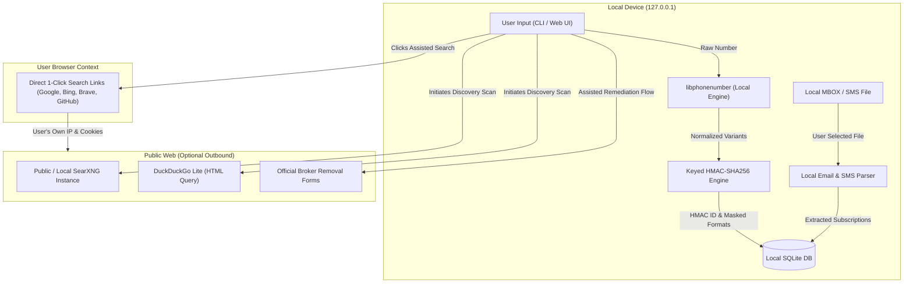

# NumberShield — Privacy Policy & Architecture

## 1. Core Privacy Philosophy

**NumberShield is designed on the principle of Zero Trust and Zero Egress.**
Privacy tools that collect personal phone numbers to "protect" them create an ironic honeypot. NumberShield solves this by keeping all storage, parsing, normalization, and verification on the user's local machine.

### Key Commitments
1. **Zero External Telemetry**: No Google Analytics, no Mixpanel, no Sentry, no tracking pixels, and no third-party CDNs.
2. **Zero Third-Party Database Uploads**: Your phone number is never submitted to a centralized cloud database, search indexing service, or commercial aggregator.
3. **Local-First Execution**: The application runs entirely on `127.0.0.1` via a local Python backend and React frontend.
4. **Keyed Cryptographic Masking**: Unsalted hashes can be reversed with simple rainbow tables because the space of valid telephone numbers is small. NumberShield uses a locally generated 256-bit secret key to generate HMAC-SHA256 tokens for database indexing.
5. **Universal Log Redaction**: All console and log outputs redact telephone numbers before printing or persisting.
6. **Total Cryptographic Erasure (`/purge`)**: A single command wipes the local database, clears history, rotates encryption keys, and leaves zero residual data.

---

## 2. Data Flow Architecture

---

## 3. Masking & Redaction Rules

When displaying or printing telephone numbers, NumberShield applies contextual masking:

| Representation | Format Example | Used In |
| :--- | :--- | :--- |
| **Masked Display** | `+1 (415) •••-••71` | Dashboard UI, reports, notifications |
| **Masked International**| `+44 •••• •••890` | International listings |
| **Keyed HMAC ID** | `a8f3b2049e7...` | SQLite primary/foreign keys |
| **Scrubbed Log Token** | `[REDACTED_PHONE_E164]` | Application console logs |
| **Unmasked Form** | `+14155552671` | Ephemeral memory during scan execution only |

---

## 4. Local Cryptographic Purge Specification

Users have an absolute right to complete data erasure. Invoking the purge mechanism (via CLI `numbershield purge` or Web UI **"Purge All Data"**):
1. Drops all SQLite tables (`exposures`, `remediation_actions`, `subscriptions`, `spam_incidents`).
2. Overwrites the database file with zeroed bytes before deletion.
3. Deletes `.numbershield_key` and regenerates a fresh 256-bit entropy seed.
4. Truncates all log files.
5. Clears browser local storage and active session memory.

---

## 5. Audit Export Format

When exporting an exposure report for regulatory complaints or personal records:
- The exported report contains **masked phone representations only**.
- Discovered URLs, timestamps, proof snippets, and remediation reference numbers are included.
- No device identifiers, MAC addresses, or IP addresses are written to the report.
